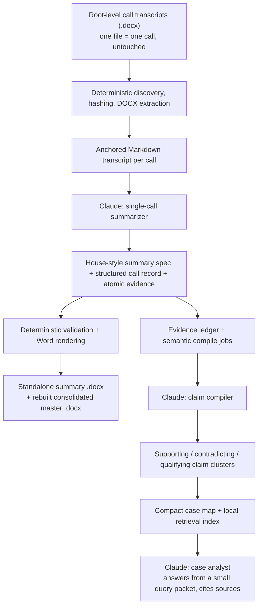

# Expert Call Intelligence

### A Claude Code plugin that turns raw expert-call transcripts into a trustworthy, queryable case record

Expert-call diligence produces a pile of Word transcripts and, eventually, a slide with a number on it. Everything in between — reconciling ten experts who disagree, tracking which claims corroborate each other versus just repeat each other, remembering exactly which paragraph a stat came from — is normally done by hand, under time pressure, and it shows.

This plugin automates that middle part, with Claude Code doing the reading and a small deterministic helper doing the bookkeeping.

## What it does

Drop one raw transcript `.docx` per expert call into a case folder, and the plugin produces:

- **One polished, house-style summary per call**, rendered as its own Word document
- **One continuously rebuilt master compilation** across all calls
- **An atomic evidence ledger** — every material assertion traced back to an exact paragraph anchor in its source transcript
- **A claim registry** clustering supporting, contradicting, and qualifying evidence across calls, instead of quietly averaging disagreement away
- **Supplier / customer / competitor maps** built from the calls themselves
- **A compact case map** for answering questions without re-reading the whole archive
- **Provenance-aware answers** to natural-language questions, through Claude Code

## How it works



Deterministic code handles the failure-prone mechanical parts — file discovery, hashing, DOCX parsing, Word rendering, indexing. Claude handles the parts that need judgment — summarizing a call, clustering claims, answering questions. Each stays in its lane.

The master compilation is **rebuilt** on every run, not appended to, so re-processing never leaves stale duplicate sections behind. Case questions are answered from a compact retrieval packet rather than loading the entire call archive into context.

## Operating rules

A few rules are fixed into how the plugin behaves, because diligence work has no room for a model quietly filling gaps:

- Never edit, rename, move, or overwrite the original transcript files — the source is immutable.
- Preserve exact numbers, definitions, denominators, scope, and uncertainty, always with provenance back to the original passage.
- Never resolve competing expert claims by averaging or guessing — disagreement is recorded, not smoothed over.
- Never count duplicate or derivative sources as independent corroboration.
- Every material claim traces back to an exact anchor in the source transcript.
- No web search or invented outside "verification" unless explicitly asked for.

## What you get

```
_Expert_Call_System/
├── 01_Processed_Summaries/     one polished, house-style summary per call
├── 02_Knowledge_Pack/
│   ├── Entities/                supplier / customer / competitor maps
│   └── Sources/                 per-source quality and corroboration notes
├── 03_Compiled_Output/          Expert_Call_Notes_Master.docx — the living consolidated record
└── 04_Review_Queue/             anything the model flagged as needing a human look
```

Every claim in every one of those files carries a `[P####]` anchor pointing back to the exact paragraph it came from.

## Quickstart

1. Open your SharePoint/OneDrive-synced case folder in File Explorer.
2. Unzip this package **directly into that folder** (not into a new wrapper folder).
3. Confirm you can see `README_FIRST.md`, `CLAUDE.md`, `.claude/`, and `_Expert_Call_System/`.
4. Drop one raw transcript `.docx` per expert call into the root of the folder.
5. Launch Claude Code from that root (`launchers/START_CLAUDE_CODE.cmd` / `.ps1` / `.sh`, or just `claude`).
6. Accept workspace trust on first launch.

### Commands

| Command | What it does |
|---|---|
| `/expert-calls:process-calls` | Process new or changed transcripts, render summaries, rebuild the master doc and case index |
| `/expert-calls:compile-case` | Rebuild the evidence/claim layer without re-summarizing unchanged calls |
| `/expert-calls:ask-case <question>` | Answer from the compact case pack, with competing evidence and source traceability |

Example queries:

```text
/expert-calls:ask-case What competing views exist on supplier qualification time?
/expert-calls:ask-case Why is Supplier A gaining share, and what evidence cuts against that view?
/expert-calls:ask-case How firm is the customer order book, by funnel stage?
```

## Under the hood

- **Three-layer evidence model**: source evidence (one expert, one call, one atomic assertion) → claim clusters (normalized propositions linking supporting/contradicting/qualifying evidence) → case map (a compact index of where knowledge and disagreement live).
- **Atomicity by design**: a single evidence record captures one metric, one entity, one time period, one claim — so two experts can agree on part of a statement and disagree on the rest without ambiguity.
- **Cross-platform helper binary** (Go, dependency-free) handles hashing, DOCX extraction, schema validation, Word rendering, and local search. It runs entirely in the local filesystem — no network calls. Claude handles the semantic work through your authenticated Claude Code session.
- **No daemon, no scheduler.** You run it when you want it run.

## Repo layout

```
.
├── CLAUDE.md                          operating rules for the case folder
├── README_FIRST.md                    install steps (copied into the case folder)
├── launchers/START_CLAUDE_CODE.{cmd,ps1,sh}  one-click launchers (start Claude Code in the parent folder)
├── _Expert_Call_System/                output tree (starts empty, fills up as you process calls)
└── .claude/skills/expert-call-intelligence/
    ├── agents/                        call-summarizer, case-analyst, claim-compiler
    ├── skills/                        process-calls, compile-case, ask-case
    ├── docs/                          architecture, data dictionary, troubleshooting
    ├── references/                    evidence model, claim rules, entity normalization, style guide
    ├── schemas/                       example JSON schemas for call records and claim shards
    ├── source/expertcall/             Go source for the helper binary
    └── bin/                           prebuilt helper binaries (macOS, Linux, Windows — amd64 + arm64)
```

## Requirements

- [Claude Code](https://claude.com/claude-code)
- A case folder of expert-call transcripts as `.docx` files

## License

No license file is currently included — all rights reserved by default until one is added. Open an issue if you'd like to use this and need a specific license.
